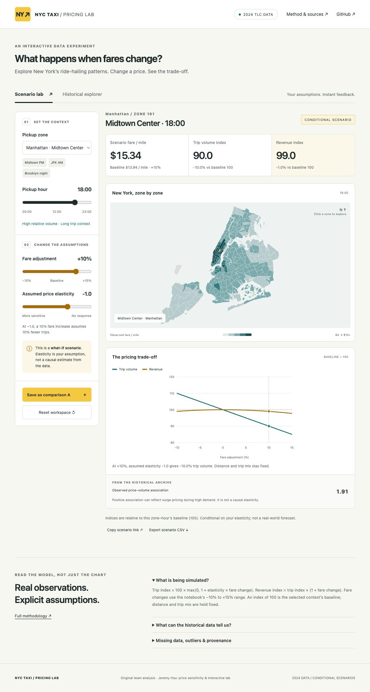

🚕 NYC Taxi Pricing & Demand Analysis

## Interactive pricing lab

Explore the NYC zone map, adjust fares and assumed elasticity, and compare trip-volume / revenue indices. Historical observations and conditional scenarios are presented separately.

[App source & local demo](web/) · [Method & data provenance](docs/interactive-lab.md)



```bash
cd web
npm test
npm run dev
# Open http://localhost:4173
```

---

A large-scale analysis of NYC Taxi (TLC High Volume FHV) data —
uncovering how price, demand, and revenue interact across time and space.

📊 Project Highlights

🔍 Demand Trends: When & where trips surge (Module 1)

💸 Price Sensitivity: Which areas react most to pricing (Module 2)

⚖️ Supply Imbalance: Detect zones needing surge pricing (Module 3)

💰 Revenue Efficiency: Find top-earning & high-efficiency zones (Module 4)

⚙️ Tech Stack

Python · Polars · Pandas · Seaborn · Plotly · Geopandas · Jupyter

🚀 Quick Start
git clone https://github.com/Jeremy891102/NYC-Taxi-Pricing-Demand-Analysis.git
cd nyc-taxi-pricing-analysis
pip install -r requirements.txt

from src.data_loader import TLCDataLoader

loader = TLCDataLoader("data/raw")
df = loader.load_in_batches(
    features=["pickup_hour", "pickup_zone", "avg_price_per_mile"],
    months=[f"2024-{i:02d}" for i in range(1,13)],
    batch_size=3
)
df.head()

📈 Example Insights

“Manhattan Friday 6–9 PM demand ↑ 40%,
JFK shows low price sensitivity (−3%),
while Brooklyn off-peak yields high efficiency (+25%).”

🧩 Modules:
Harvey (Demand) | Jeremy (Price) | Royan (Imbalance) | Desmond (Revenue)
Last Updated: Nov 2025
